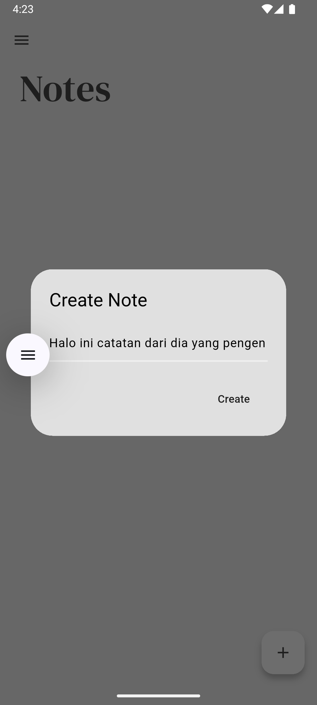
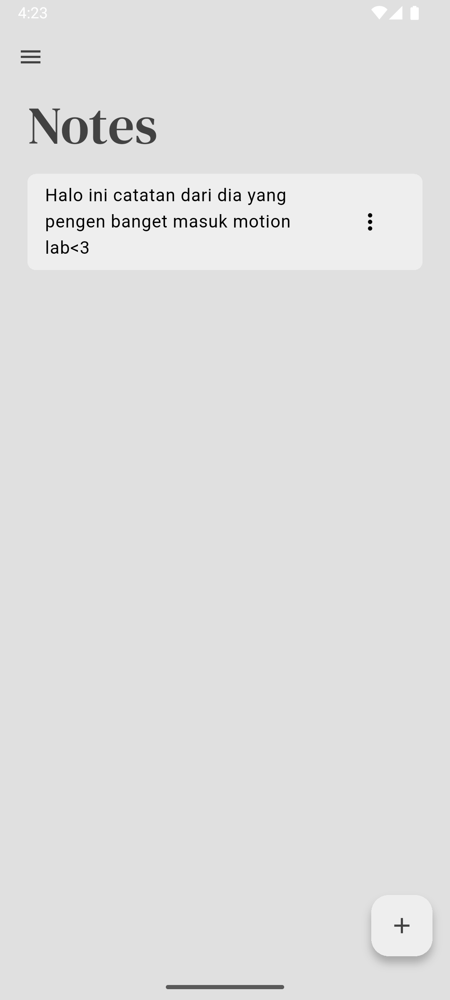
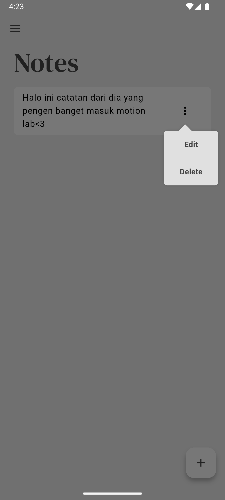
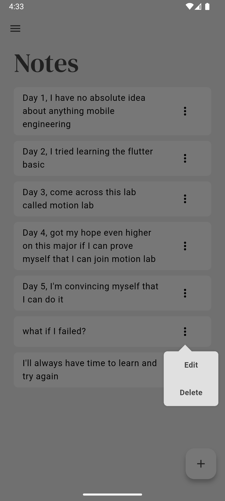
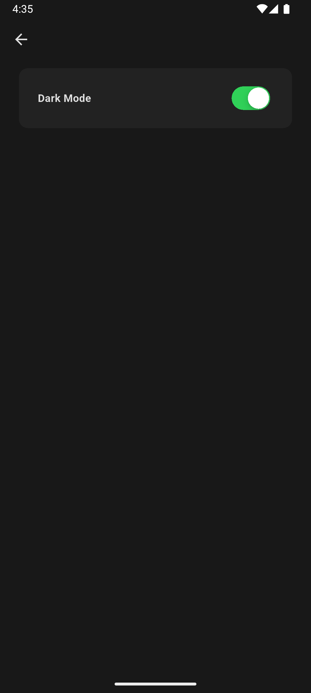
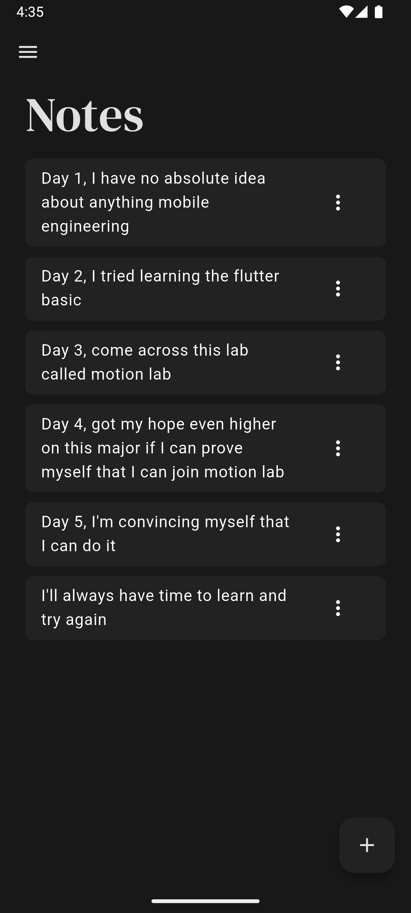

# Simple Note App
by Bilqis Mufida (103022500019)

## Demo Application

### Screen Shot
**Create**

**Edit**

**Delete**

**Dark Mode**

## How to Run
**Create New Note**
1. Click floating add button to create new note
2. Type note in form input
3. Click 'Create Button'

**Edit Note**
1. Click Option button on existing note
2. Select 'edit' option
3. Type anything needed to change older note
4. Click 'Update'

**Delete Button**
1. Click option button on existing note
2. Select 'delete' option

**Change Theme**
1. Click burger menu on top left
2. Choose 'Settings' button
3. Toggle 'Dark Mode'

### Deklarasi Penggunaan AI
- **Apakah menggunakan AI:** Ya
- **Tool AI yang digunakan:** ChatGPT (GPT-6)

- **Estimasi persentase kontribusi AI:** 10%

- **Bagian kode/fitur yang dibantu AI:**
  - Memberikan panduan penggunaan Flutter dan Dart di Visual Studio Code, termasuk pembuatan file Dart dan penggunaan snippet StatefulWidget.
  - Membantu konfigurasi environment Flutter, Android Studio, dan Android Emulator untuk menjalankan aplikasi.
  - Membantu mengatasi error pada proses build aplikasi, seperti konfigurasi Gradle, Android SDK, NDK, dan dependency Isar.
  - Memberikan referensi penggunaan fitur Hot Reload dan debugging selama pengembangan aplikasi.

- **Pernyataan:** Saya menyatakan bahwa saya memahami alur dan fungsi dari seluruh kode yang ada dalam repositori ini
